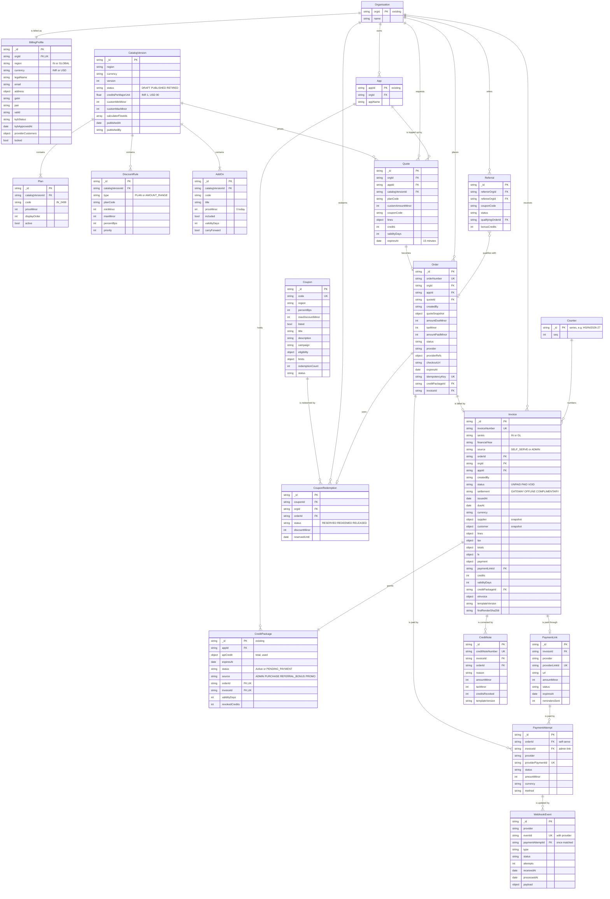
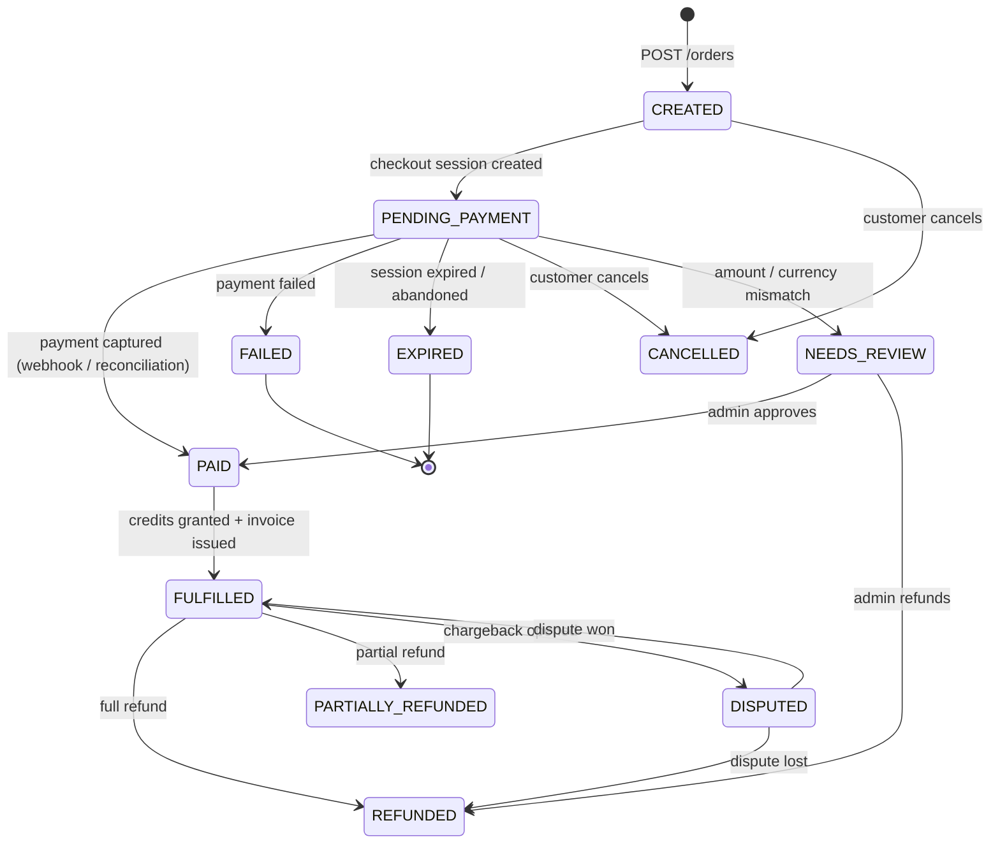
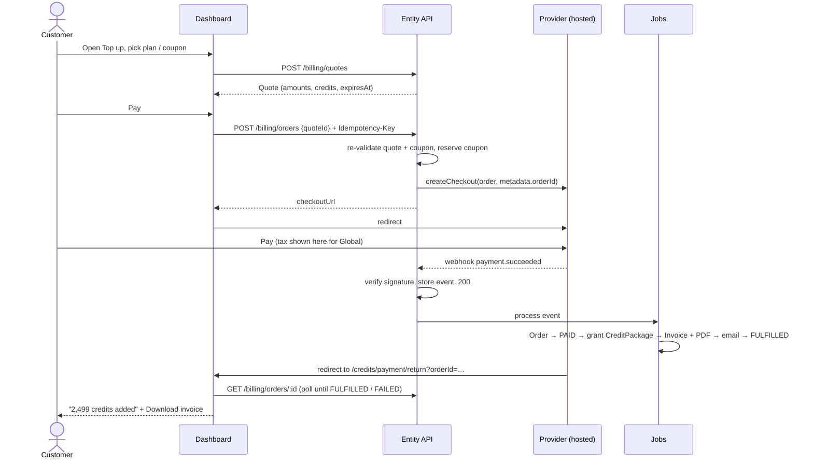
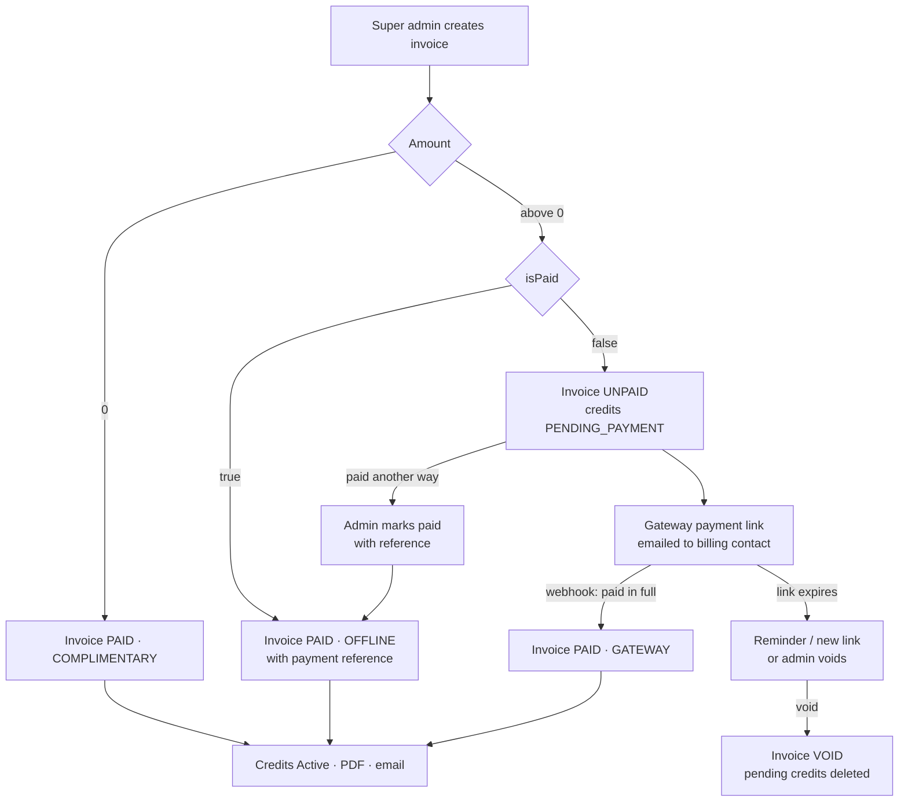

# ADR: Self-serve credit top-up and payments

| | |
|---|---|
| **Status** | Proposed |
| **Date** | 2026-10-22 (updated 2026-10-28 to match the popup agreed with Business) |
| **Author** | Vishwas Bhushan |
| **Deciders** | Engineering (entity API, studio server, dashboard), Business, Finance |
| **ADR number** | To be assigned (follows ADR-011) |

## 1. Context

Today, customers cannot buy credits themselves. A super admin grants them by hand from **Super Admin › Credit Recharge**, which calls the entity API:

| Today | Endpoint |
|---|---|
| Grant credits to an app | `POST /app/:appId/credits` with `{ amount, amountDenom, validityPeriod, validityPeriodUnit }` |
| List an app's credit packages | `GET /app/:appId/credits` (returns `apiCredit.total`, `apiCredit.used`, `expiresAt`, `status`) |
| Activate a package | `POST /app/:appId/credits/:creditId/activate` |

The pricing team has agreed the commercial model, and the dashboard UI is built for sign-off (`src/components/credit/CreditTopUpPopup.vue`, with mock pricing in `creditTopUpPricing.js`):

- **Two billing regions, India and Global.** The region comes from where the customer is taxed, as given on the onboarding form. India pays in INR and Global pays in USD.
- **Plans with a fixed discount each.** India: ₹999 / ₹2,499 / ₹4,999 / ₹9,999 at 10 / 25 / 28 / 35% off (prices exclude GST). Global: $99 / $199 / $299 / $499 / $1,499 at 0 / 40 / 46.5 / 52 / 55% off. A customer can also click **Custom amount** and enter any amount between the smallest and largest plan (₹999–₹9,999 or $99–$1,499).
- **Add-ons that are free today but must be shown.** These are credit validity (1 month for India, 6 months for Global, with no carry-forward), 24×7 human support and email support.
- **Coupons tied to a region.** Only **FOUNDING15** (Global) and **FOUNDING8** (India) are active at launch. REFER, PARTNER and WINBACK are designed but switched off (see §4.3). Customers apply a coupon from a small **Apply a coupon** dialog, where they can type a code or pick from the offers listed for them.
- **1 credit = ₹1.** A discount lowers the price, not the number of credits. Global top-ups get 90 credits per $1 (still to be confirmed).
- **"Understand your credits"** opens the Credit Calculator, so the customer can see how many verifications the top-up covers. It only shows the verification flows for their region: Non-Doc ID Verification (India) for India, and Global Identity Verification and Business Verification for Global.
- **Tax is shown on the payment page,** based on the customer's jurisdiction.
- **Payment happens on a hosted gateway page.**

Business has also agreed how invoicing and manual grants work:

- **Invoicing is managed by our system, not by the payment gateway.** We expect to use more than one gateway, and some gateways don't offer invoicing at all. Gateways only run checkout pages and payment links.
- **A super admin can create an invoice for any ID Service app** with an **amount** and an **isPaid** flag. This replaces today's direct credit grant for ID Service. SSI Service recharges are unchanged.
  - **Amount 0:** free credits. The invoice is issued and the credits are active straight away.
  - **isPaid = true:** the payment was already taken in another system (for example a bank transfer). We only issue the invoice and recharge the credits.
  - **isPaid = false:** we generate a payment link for the amount. The credits only become active once the customer pays it.

This ADR decides how the backend supports both flows: self-serve top-ups and super-admin invoices.

## 2. Decision summary

1. **The server is the only source of truth for prices.** The dashboard sends *what* the customer picked (a plan id or a custom amount, plus a coupon code). The server returns a **quote** with every amount worked out. Amounts sent by the client are never trusted.
2. **Money is stored as integers in minor units** (paise, cents). Percentages are stored as integer **basis points** (46.5% = `4650`). There are no floating-point numbers anywhere.
3. **The region is fixed by the organisation's billing profile,** not chosen in the UI. The "Preview as" switch in the popup exists only for the sign-off build.
4. **Pricing is versioned.** Plans, discounts and add-ons belong to a **catalog version** that is published as a whole. Every quote, order and invoice records the version it used.
5. **Credits are granted only after a verified gateway webhook,** never after the browser redirect. The grant is idempotent per order.
6. **Payment gateways sit behind a `PaymentProvider` interface,** and a router picks the provider by region and currency. We start with hosted checkout pages, which keeps card data off our servers (PCI SAQ-A).
7. **Our system owns invoicing; gateways only take payments.** We issue every invoice ourselves, numbered in sequence, and render it as a PDF on request (we don't store PDF files, §8.3). Customers download it from the dashboard. Invoices don't depend on any gateway, so we can run several gateways, including ones without invoicing. Gateway receipts are extras and are not the invoice of record.
8. **Purchased credits reuse the existing credit package model.** Each package gains a `source`, `orderId` and `invoiceId`, so consumption, expiry and the dashboard's balance view keep working unchanged.
9. **Every ID Service credit grant is backed by an invoice.** Self-serve purchases get an invoice when they are paid. Super-admin grants get one when they are created, including ₹0 grants. The existing `POST /app/:appId/credits` becomes an internal step that runs once an invoice is settled, and is no longer called directly from the super-admin page for ID Service. **SSI Service recharges stay as they are, without invoices,** for now (open question 16).
10. **Super-admin invoices settle in one of three ways** (§8.2): complimentary (amount 0), paid offline (`isPaid = true`), or paid through a gateway payment link (`isPaid = false`). Credits for an unpaid invoice are created as `PENDING_PAYMENT` and are activated only by a verified payment.

### Invoice scenarios at a glance

A plain-language summary for leadership.

1. **Customer buys credits themselves.** They pick a plan and pay online. Once the payment goes through, credits are added and the invoice is issued as **Paid**. If they leave without paying, no invoice is created.
2. **We give free credits.** Our team creates a ₹0 invoice. Credits are added straight away, and the invoice is marked **Complimentary**.
3. **Customer paid us outside the dashboard** (for example, a bank transfer). Our team creates an invoice for the amount and marks it as already paid, with the payment reference. Credits are added straight away, and the invoice is marked **Paid**.
4. **Customer still needs to pay.** Our team creates an invoice for the amount, marked **Payment due**. The customer gets a payment link by email, and the invoice carries a QR code. The credits show as "Awaiting payment" and can't be used yet. Once the customer pays, the credits start working and the invoice changes to **Paid**. If they don't pay within 15 days, we send a new link or cancel the invoice, and cancelled invoices never give credits.

Every purchase in the customer's credit history shows its invoice and a **Download** button. Unpaid invoices also have **Pay now**.

## 3. Scope

**In scope:** pricing catalog, coupons, quotes, orders, gateway integration (checkout and payment links), webhooks, credit grant, tax handling, invoices and credit notes, super-admin invoices (complimentary, paid offline, or paid by link), refunds by admins, reconciliation, invoice exports, and the admin APIs to manage all of these.

**Out of scope for v1** (the data model leaves room for them): auto-recharge, subscriptions, saved payment methods, customer-initiated refunds, wallets or credit transfer between apps, paying in other currencies, and **invoicing for SSI Service recharges** (these keep today's direct recharge).

## 4. Data model

The collections below are new unless marked otherwise. `_id` follows the existing Mongo convention. Every document has `createdAt`/`updatedAt`. Money fields end in `Minor` and always sit next to a `currency`.

**Entity-relationship diagram.** The diagram below shows every collection in this section, with its fields, keys (`PK`, `FK`, `UK` for unique) and relationships. It also shows the existing **Organisation**, **App** and **CreditPackage** records, to show where the new data attaches. It renders directly on GitHub and GitLab, in VS Code's Markdown preview, and at [mermaid.live](https://mermaid.live). The same model is in [Appendix A](#appendix-a-er-diagram-in-dbml) as DBML for [dbdiagram.io](https://dbdiagram.io).



### 4.1 BillingProfile (one per organisation)

This holds who is paying and where they are taxed. It is filled in from onboarding/KYB, and the customer can confirm or complete it before their first purchase.

```ts
interface BillingProfile {
  orgId: string;                 // the entity/organisation that owns the apps
  region: 'IN' | 'GLOBAL';       // set from the onboarding tax country; only an admin can change it
  currency: 'INR' | 'USD';       // set by the region
  legalName: string;
  email: string;                 // invoices are sent here
  address: { line1; line2?; city; state?; stateCode?; postalCode; country };  // stateCode: Indian GST state code
  taxIds: {
    gstin?: string;              // India B2B. Its first 2 digits are the place-of-supply state
    pan?: string;
    vatId?: string;              // Global, optional
  };
  kybStatus: 'NOT_STARTED' | 'PENDING' | 'APPROVED' | 'REJECTED';  // copied from KYB; coupons use it
  kybApprovedAt?: Date;
  providerCustomers: { [provider: string]: string };              // e.g. { stripe: 'cus_…' }
  locked: boolean;               // true after the first paid order; region/tax ID changes then need review
}
```

### 4.2 CatalogVersion, Plan, DiscountRule, AddOn

There is exactly one **published** catalog version per region at any time. Admins edit a **draft** and publish it, and publishing never changes past orders.

```ts
interface CatalogVersion {
  region: 'IN' | 'GLOBAL';
  currency: 'INR' | 'USD';
  version: number;                       // increases per region
  status: 'DRAFT' | 'PUBLISHED' | 'RETIRED';
  creditsPerMajorUnit: number;           // INR: 1. USD: the agreed rate (90 in the popup, to be confirmed). Fixed per version, not live FX
  custom: { enabled: boolean; minMinor: number; maxMinor: number };  // the smallest/largest plan: ₹999–₹9,999, $99–$1,499
  calculatorFlowIds: string[];           // Credit Calculator flows for this region. IN: ['india'], GLOBAL: ['global', 'business']
  publishedAt?: Date;
  publishedBy?: string;
}

interface Plan {
  catalogVersionId: string;
  code: string;                          // 'IN_2499', 'GL_199'; stable across versions
  priceMinor: number;                    // 249900 paise, excluding tax
  displayOrder: number;
  active: boolean;
}

interface DiscountRule {
  catalogVersionId: string;
  type: 'PLAN' | 'AMOUNT_RANGE';
  planCode?: string;                     // type PLAN
  minMinor?: number; maxMinor?: number;  // type AMOUNT_RANGE (custom amounts, or tiered pricing later)
  percentBps: number;                    // 2000 = 20%
  priority: number;                      // the highest matching rule wins; plan discounts never stack with each other
}

interface AddOn {
  catalogVersionId: string;
  code: 'VALIDITY' | 'HUMAN_SUPPORT_24X7' | 'EMAIL_SUPPORT' | string;
  title: string; shortTitle: string; description: string; icon?: string;
  priceMinor: number;                    // 0 today; shown as "Free"
  included: boolean;                     // true = always on, no checkbox
  config?: { validityDays?: number; carryForward?: boolean };  // VALIDITY: IN 30, GLOBAL 180
}
```

**Custom amounts** get a discount from an `AMOUNT_RANGE` rule. For the agreed model, the backend generates one rule per plan, covering amounts from that plan up to the next one. A custom ₹3,200 therefore gets the ₹2,499 plan's 25%, and a custom $350 gets the $299 plan's 46.5%. This matches the current UI.

**Add-ons have no backend support today,** but they are delivered anyway. The validity add-on is the one that really affects behaviour: it sets `expiresAt` on the credit package we grant. The support add-ons are display and entitlement records only.

### 4.3 Coupon and CouponRedemption

```ts
interface Coupon {
  code: string;                          // stored in upper case, unique
  region: 'IN' | 'GLOBAL';
  percentBps: number;                    // 1500 = 15% off checkout
  maxDiscountMinor?: number;             // optional cap
  listed: boolean;                       // true: offered in the coupon dialog to eligible orgs. false: can only be typed (e.g. emailed codes)
  title: string;                         // shown in the dialog, e.g. 'Founding customer offer'
  description: string;                   // customer-facing terms, e.g. 'For our first 500 verified Indian businesses…'
  campaign: 'FOUNDING' | 'REFERRAL' | 'PARTNER' | 'WINBACK' | string;
  eligibility: {
    requiresKybApproved?: boolean;       // FOUNDING
    requiresTaxId?: ('GSTIN' | 'PAN')[]; // FOUNDING8
    firstPurchaseOnly?: boolean;         // REFER*
    maxPurchasesPerOrg?: number;         // FOUNDING: 3
    withinDaysOfKybApproval?: number;    // FOUNDING: 180
    minDaysSinceLastPurchase?: number;   // WINBACK: 60
    allowedOrgIds?: string[];            // WINBACK (emailed only), or partner cohorts
    referrerOrgId?: string;              // REFER: one code per referrer, or resolved from the referral record
    partnerId?: string;                  // PARTNER
  };
  limits: {
    maxRedemptions?: number;             // FOUNDING: first 500 entities; PARTNER: per-code cap
    maxRedemptionsPerOrg?: number;       // WINBACK: 1
    startsAt?: Date; expiresAt?: Date;   // PARTNER: 90 days; WINBACK: 14 days from issue
  };
  redemptionCount: number;               // updated atomically; see edge cases
  status: 'ACTIVE' | 'PAUSED' | 'EXPIRED';
}

interface CouponRedemption {
  couponId: string; code: string; orgId: string; orderId: string;
  status: 'RESERVED' | 'REDEEMED' | 'RELEASED';
  discountMinor: number;
  reservedUntil: Date;                   // set to the order expiry
}
```

**Coupons at launch.** Only the two FOUNDING codes are active. Both are `listed`, so eligible customers see them in the coupon dialog.

| Code | Region | Off | Listed | Eligibility | Limits |
|---|---|---|---|---|---|
| FOUNDING15 | Global | 15% | Yes | First 500 KYB-verified entities | First 3 purchases within 6 months of KYB approval |
| FOUNDING8 | India | 8% | Yes | First 500 KYB-verified Indian entities (GSTIN/PAN) | First 3 purchases within 6 months |

**Designed but not active at launch.** The schema already supports these, so switching them on later needs only data, apart from the referral job (§5.4).

| Code | Region | Off | Eligibility | Limits |
|---|---|---|---|---|
| REFER10 / REFER5 | Global / India | 10% / 5% | Referred by a paying customer | First purchase only; the referrer gets 5% of the order as bonus credits once the referee has used 50% |
| PARTNER10 / PARTNER5 | Global / India | 10% / 5% | Accelerator, chain or ecosystem cohorts | One code per partner, maximum uses per code, expires in 90 days |
| WINBACK10 / WINBACK5 | Global / India | 10% / 5% | No purchase in 60+ days | One use, emailed only, expires in 14 days (would be unlisted) |

**Which coupons are listed.** The dialog only lists coupons that are `listed`, `ACTIVE`, for the org's region, **and that the org is eligible for right now** (for example, FOUNDING8 only after KYB approval and while the org has used it fewer than 3 times). A customer never picks a listed offer that is then rejected.

**Referrals** need one more collection:

```ts
interface Referral {
  referrerOrgId: string;
  refereeOrgId: string;
  couponCode: string;
  status: 'PENDING' | 'QUALIFIED' | 'BONUS_GRANTED' | 'VOID';
  qualifyingOrderId?: string;
  bonusCredits?: number;
}
```

A job grants the referrer's bonus once the referee's qualifying package reaches 50% used. The bonus is a `CreditPackage` with `source: 'REFERRAL_BONUS'`.

### 4.4 Quote

A quote is a short-lived, server-priced snapshot. The popup asks for a new one every time the selection or coupon changes.

```ts
interface Quote {
  orgId: string; appId: string; region; currency;
  catalogVersionId: string;
  selection: { planCode?: string; customAmountMinor?: number };
  lines: {
    subtotalMinor: number;               // the plan price or custom amount
    planDiscount: { percentBps: number; amountMinor: number; ruleId: string };
    coupon?: { code: string; percentBps: number; amountMinor: number };
    addOns: { code: string; title: string; priceMinor: 0 }[];
    totalBeforeTaxMinor: number;
    taxEstimate?: { amountMinor: number; breakdown: TaxLine[] };  // India only (see §7)
  };
  credits: number;
  validityDays: number;
  expiresAt: Date;                       // 15 minutes
}
```

**Rounding.** Each step rounds half-up to a whole minor unit, and coupons apply after the plan discount. Both examples match the popup:

- **₹2,499 with FOUNDING8:** the plan discount is 25% × 249900 = 62475, and the coupon is 8% × 187425 = 14994. The customer pays 172431 paise = **₹1,724.31**.
- **$299 with FOUNDING15:** the plan discount is 46.5% × 29900 = 13903.5, which rounds to 13904. The coupon is 15% × 15996 = 2399.4, which rounds to 2399. The customer pays 13597 cents = **$135.97**.

**Credits.** These are `floor(subtotalMinor × creditsPerMajorUnit / 100)`, based on the price before discount.

### 4.5 Order, PaymentAttempt, WebhookEvent

```ts
interface Order {
  orderNumber: string;                   // 'ORD-2026-000123', shown to the customer
  orgId: string; appId: string; createdBy: string;  // the dashboard user
  quoteSnapshot: Quote['lines'] & { credits; validityDays; catalogVersionId };
  currency; region;
  amountDueMinor: number;                // before tax
  taxMinor?: number;                     // final, from the provider (Global) or our calculation (India)
  amountPaidMinor?: number;
  status: OrderStatus;                   // see the state machine below
  provider: 'stripe' | 'razorpay' | string;
  providerRefs: { checkoutId?: string; paymentId?: string; customerId?: string };
  checkoutUrl?: string;
  expiresAt: Date;                       // when the checkout session expires
  idempotencyKey: string;                // sent by the client, unique per org
  creditPackageId?: string;
  invoiceId?: string;
  failureReason?: string;
}

interface PaymentAttempt {
  orderId?: string; invoiceId?: string;  // self-serve order, or super-admin invoice paid by link
  provider: string; providerPaymentId: string;
  status: 'PENDING' | 'AUTHORIZED' | 'CAPTURED' | 'FAILED' | 'REFUNDED' | 'PARTIALLY_REFUNDED' | 'DISPUTED' | 'NEEDS_REVIEW';
  amountMinor: number; currency: string; method?: string;  // card / upi / netbanking / link …
  raw?: object;                          // trimmed provider payload, for support
}

interface WebhookEvent {
  provider: string;
  eventId: string;                       // unique (provider, eventId) index, so duplicates are skipped
  paymentAttemptId?: string;             // set once the event is matched to a payment
  type: string;
  receivedAt: Date; processedAt?: Date;
  status: 'RECEIVED' | 'PROCESSED' | 'IGNORED' | 'FAILED';
  error?: string; attempts: number;
  payload: object;
}
```

**Order state machine.** Transitions only move forward. Late or duplicate events that would move an order backwards are recorded and ignored.



### 4.6 CreditPackage (existing, extended)

We keep the existing per-app credit document. Its `apiCredit.total`, `apiCredit.used`, `expiresAt` and `status` fields are unchanged. We add these fields:

```ts
{
  source: 'ADMIN' | 'PURCHASE' | 'REFERRAL_BONUS' | 'PROMO';  // existing records backfill to 'ADMIN'
  orderId?: string;                      // unique sparse index, so one order can grant credits only once
  invoiceId?: string;                    // unique sparse index, so one invoice can grant credits only once
  validityDays: number;
  carryForward: false;
  revokedCredits?: number;               // set by a refund or dispute; remaining = total - used - revoked
}
```

The package `status` gains one value, **`PENDING_PAYMENT`**, for credits on an unpaid super-admin invoice. These credits are visible in the dashboard as "Awaiting payment" but cannot be used. They change to `Active` when the invoice is paid, and their validity starts from that moment, not from when the invoice was created.

### 4.7 Invoice and CreditNote

```ts
interface Invoice {
  invoiceNumber: string;                 // sequential per series, with no gaps (see §8)
  series: 'IN' | 'GL';
  financialYear?: string;                // India: '2026-27'
  source: 'SELF_SERVE' | 'ADMIN';
  orderId?: string;                      // SELF_SERVE only
  orgId: string; appId: string;
  createdBy?: string;                    // ADMIN: the super admin who created it
  issuedAt: Date;
  dueAt?: Date;                          // ADMIN unpaid: the payment link's expiry
  status: 'UNPAID' | 'PAID' | 'VOID';
  settlement: 'GATEWAY' | 'OFFLINE' | 'COMPLIMENTARY';
  note?: string;                         // ADMIN: internal reason, not printed
  supplier: { legalName; address; gstin?; pan?; sac?: string };  // snapshot of our own entity details
  customer: BillingProfile snapshot;     // copied, never live-linked
  placeOfSupply?: string;                // India: state code
  lines: { description; sac?; quantity: 1; unitPriceMinor; discountMinor; taxableMinor }[];
  tax: { type: 'CGST' | 'SGST' | 'IGST' | 'VAT' | 'SALES_TAX' | 'ZERO_RATED_EXPORT'; rateBps; amountMinor; jurisdiction? }[];
  totals: { subtotalMinor; discountMinor; taxableMinor; taxMinor; totalMinor; amountPaidMinor };
  currency;
  fx?: { inrPerUnit: number; rateDate: Date; totalInrMinor: number };  // USD invoices: INR value for GST and export reporting
  payment?: {
    provider?: string; paymentId?: string; method?: string;  // GATEWAY
    reference?: string;                  // OFFLINE: bank transfer UTR, cheque number, other system's receipt id
    paidAt: Date;
  };
  paymentLinkId?: string;                // ADMIN unpaid
  credits: number; validityDays: number;
  creditPackageId: string;
  eInvoice?: { irn: string; ackNo: string; ackDate: Date; signedQr: string };  // India B2B, if e-invoicing applies (§8.4)
  templateVersion: string;               // the PDF template it was issued with, e.g. 'invoice-v1' (§8.3)
  firstRenderSha256?: string;            // hash of the PDF as first sent to the customer, for evidence
  voidedAt?: Date; voidReason?: string;
}

interface PaymentLink {
  invoiceId: string;
  provider: string;                      // chosen by region, like checkout
  providerLinkId: string;
  url: string;
  amountMinor: number; currency: string; // the invoice total including tax
  status: 'ACTIVE' | 'PAID' | 'EXPIRED' | 'CANCELLED';
  expiresAt: Date;                       // default 15 days
  sentTo: string[];                      // billing email + any extra recipients
  remindersSent: number;
}

interface CreditNote {
  creditNoteNumber: string; invoiceId: string; orderId: string;
  reason: 'REFUND' | 'DISPUTE_LOST' | 'CORRECTION';
  amountMinor: number; taxMinor: number;
  creditsRevoked: number;
  templateVersion: string; firstRenderSha256?: string;
}
```

## 5. APIs

All customer endpoints sit under the entity API (`apiServer`), are authenticated like the existing `/app/:appId/credits` routes, and are scoped to the caller's organisation. Write calls need a new `BILLING_WRITE` permission (or the existing `WRITE_CREDIT`); read calls need `BILLING_READ`.

### 5.1 Customer

| Method & path | Purpose | Notes |
|---|---|---|
| `GET /billing/profile` | Get the billing profile | Prefilled from onboarding/KYB. |
| `PUT /billing/profile` | Complete or update billing details | Once `locked`, changing the region or tax ID returns `409` and needs a support review. |
| `GET /billing/catalog` | Get plans, discounts, add-ons, custom limits and `calculatorFlowIds` for the caller's region | Used to render the popup and to filter the Credit Calculator. Coupons are not included. |
| `GET /billing/coupons?appId&planCode\|customAmountMinor` | Listed coupons the org is eligible for right now, with `code`, `title`, `description`, `percentBps` and `previewDiscountMinor` for the current selection | Feeds the **Apply a coupon** dialog, including its "Saves ₹x on this top-up" line. Never returns unlisted codes or eligibility rules. |
| `POST /billing/quotes` | Price a selection: `{ appId, planCode \| customAmountMinor, couponCode? }` → `Quote` | Called again when the selection or coupon changes. Invalid coupon → `422 { code: 'COUPON_INVALID' }`. Rate-limited. |
| `POST /billing/orders` | `{ quoteId }` + `Idempotency-Key` header → `{ orderId, checkoutUrl, expiresAt }` | Re-checks the quote and coupon, reserves the coupon, and creates the provider checkout. |
| `GET /billing/orders/:orderId` | Order status | Polled by the payment return page. |
| `POST /billing/orders/:orderId/cancel` | Abandon an unpaid order | Releases the coupon reservation. |
| `GET /billing/orders?appId&status&page` | Purchase history | Feeds "Credit Purchase History". |
| `GET /billing/invoices?status&page` | List invoices and credit notes | Unpaid super-admin invoices are included, with a **Pay now** link to their payment link. |
| `GET /billing/invoices/:invoiceId/download` | Download a PDF | Renders the PDF on request from the stored invoice and streams it (`Content-Disposition: attachment`). Nothing is stored as a file. |
| `POST /billing/invoices/:invoiceId/email` | Resend an invoice to the billing email | Rate-limited. |

**Coupon error responses (agreed with Business).** Every rejected code returns the same `COUPON_INVALID` code: unknown, wrong region, expired, already used or not eligible. The UI always shows "This coupon code is not valid." This stops people discovering codes, and avoids region wording that Indian customers found confusing (for example "only valid for Global billing").

### 5.2 Payment provider webhooks (public)

| Method & path | Purpose |
|---|---|
| `POST /billing/webhooks/:provider` | Receives provider events. It uses the **raw body** for signature checks, stores a `WebhookEvent`, returns `200` quickly, and processes the event in a background job. |

### 5.3 Super admin

| Method & path | Purpose |
|---|---|
| `GET/POST/PATCH /admin/billing/catalogs` and `…/:id/plans`, `…/discount-rules`, `…/add-ons` | Manage draft catalog versions. |
| `POST /admin/billing/catalogs/:id/publish` | Publish a version (the previous one becomes `RETIRED`). |
| `GET/POST/PATCH /admin/billing/coupons`, `POST /admin/billing/coupons/:code/issue` | Manage coupons. `issue` creates per-org WINBACK codes or per-partner PARTNER codes. |
| `GET /admin/billing/coupons/:code/redemptions` | See who used a code. |
| `GET /admin/billing/orders?status&org&provider&from&to` | Search orders and payments. |
| `POST /admin/billing/orders/:id/refund` `{ amountMinor?, revokeCredits, reason }` | Full or partial refund. Issues a credit note. |
| `POST /admin/billing/orders/:id/reconcile` | Re-fetch the order's status from the provider. |
| `GET /admin/billing/profiles?appId` | Look up the billing profile of the org that owns an app: legal name, address, tax IDs, region and currency. Feeds the **Billed to** card on the recharge page, and the GST preview. |
| `PATCH /admin/billing/profiles/:orgId` | Unlock or correct a region or tax ID. |
| `POST /admin/billing/invoices` + `Idempotency-Key` | Create a super-admin invoice: `{ appId, credits, validityDays, amountMinor, isPaid, payment?: { method, reference, paidAt }, recipients?, note? }`. The org, region and currency come from the app's billing profile. Returns the invoice and, when unpaid, its payment link. See §8.2. |
| `GET /admin/billing/invoices?org&app&status&source&settlement&from&to` | Search all invoices. |
| `POST /admin/billing/invoices/:id/mark-paid` `{ paymentReference }` | Settle an unpaid invoice that was paid outside the link. Cancels the link and activates the credits. |
| `POST /admin/billing/invoices/:id/payment-link` | Create a new link after the old one expired. |
| `POST /admin/billing/invoices/:id/remind` | Email the payment link again. |
| `POST /admin/billing/invoices/:id/void` `{ reason }` | Void an unpaid invoice. Cancels the link and deletes the pending credits. Paid invoices can't be voided; they need a refund and credit note. |
| `GET /admin/billing/exports/invoices?from&to&format=csv` | Export invoices and credit notes for GST returns (GSTR-1) and accounting software. |
| `POST /app/:appId/credits` *(existing)* | **Internal only.** Called by invoice settlement, no longer from the super-admin page. |

### 5.4 Background jobs

| Job | Schedule | Does |
|---|---|---|
| Webhook processor | queue | Applies `WebhookEvent`s to orders. Retries with backoff, then dead-letters and alerts. |
| Reconciliation | every 10 min | For `PENDING_PAYMENT` orders older than 15 minutes, asks the provider and applies the result. Then expires stale orders and releases their coupons. |
| Fulfilment | on `PAID` | Grants the credit package, issues the invoice, generates the PDF, emails the customer, and sets the order to `FULFILLED`. |
| Referral bonus | hourly | Grants referrer bonuses for qualified referrals. |
| Daily settlement check | daily | Compares provider settlement reports with `PAID` orders and gateway-paid invoices, and reports any differences. |
| Payment link follow-up | daily | Sends reminders for unpaid super-admin invoices (for example at 3 and 7 days), marks expired links `EXPIRED`, and alerts the invoice's creator. |

## 6. Payment gateway abstraction

```ts
interface PaymentProvider {
  readonly id: string;                                   // 'stripe' | 'razorpay' | …
  supports(region: Region, currency: Currency): boolean;

  ensureCustomer(profile: BillingProfile): Promise<string>;           // provider customer id
  createCheckout(input: {
    order: Order; profile: BillingProfile;
    successUrl: string; cancelUrl: string; expiresAt: Date;
    collectTax: boolean;                                              // Global: let the provider calculate tax
  }): Promise<{ checkoutId: string; checkoutUrl: string; expiresAt: Date }>;

  createPaymentLink(input: {
    invoice: Invoice; profile: BillingProfile; expiresAt: Date; notify: { email: string[] };
  }): Promise<{ providerLinkId: string; url: string; expiresAt: Date }>;   // Razorpay Payment Links, Stripe Payment Links
  cancelPaymentLink(providerLinkId: string): Promise<void>;

  verifyWebhook(headers: Record<string, string>, rawBody: Buffer): ProviderEvent;  // throws if the signature is bad
  normalize(event: ProviderEvent): NormalizedEvent | null;           // null = event type we don't use
  getPayment(ref: { checkoutId?: string; paymentId?: string }): Promise<NormalizedPayment>;  // reconciliation
  refund(paymentId: string, amountMinor: number, reason: string): Promise<{ refundId: string }>;
}

type NormalizedEvent = {
  kind: 'PAYMENT_SUCCEEDED' | 'PAYMENT_FAILED' | 'CHECKOUT_EXPIRED' | 'PAYMENT_LINK_EXPIRED'
      | 'REFUND_SUCCEEDED' | 'DISPUTE_OPENED' | 'DISPUTE_WON' | 'DISPUTE_LOST';
  eventId: string;
  orderId?: string; invoiceId?: string;      // one of them travels in provider metadata / notes
  paymentId?: string; amountMinor: number; taxMinor?: number; currency: string;
  occurredAt: Date;
};
```

- **`PaymentRouter`** picks the provider from config (`{ IN: 'razorpay', GLOBAL: 'stripe' }`) behind a feature flag, so we can switch or add a provider without code changes. Each order keeps its provider for its whole life, so refunds and reconciliation always go to the gateway that took the payment.
- **Gateways do two jobs only: checkout sessions (self-serve) and payment links (super-admin invoices).** They never issue invoices, and no gateway feature is needed beyond those two, so any gateway that supports them can be added.
- **Domain code only ever sees `NormalizedEvent`.** Provider-specific fields stay inside the adapter and in `providerRefs` / `raw`.
- **Hosted pages only in v1:** Stripe Checkout Session, and Razorpay Payment Link or hosted checkout. The Pay button redirects to `checkoutUrl`, as the UI expects, and card data never touches our servers.
- **Recommended providers:** **Stripe** for Global (USD, cards, Apple/Google Pay, Link, and Stripe Tax for tax by jurisdiction) and **Razorpay** for India (INR, UPI, netbanking, cards and RBI-compliant flows). Final choice: open question 1.
- **Adding a provider** means writing one adapter, its webhook route, its config entry and a contract test suite. Every adapter must pass the same suite: create, succeed, fail, expire, duplicate webhook, refund.

### 6.1 Purchase flow



## 7. Tax

- **Global (Stripe).** The provider calculates tax (Stripe Tax) from the address collected at checkout. The popup's text "Final tax is calculated on the secure payment page" is accurate for this region. The final `taxMinor` comes from the success event and is written onto the invoice. For customers outside India this is an export of services, which may be zero-rated GST under a LUT; Finance needs to confirm (open question 3).
- **India.** GST at 18% applies to the amount after discounts. The tax type depends on where the customer is:
  - **Same state as our registered entity:** CGST 9% + SGST 9%.
  - **Any other state:** IGST 18%.

  The place of supply comes from the GSTIN's state code, or from the billing address state for B2C customers. Razorpay does not calculate GST, so **we calculate it in the quote**. We should then show "GST (18%) ₹x" in the popup instead of the "calculated on the payment page" text, so the amount on the Razorpay page matches what the customer saw. This is a small UI change (open question 4).
- **Super-admin invoices.** The amount the admin enters excludes tax, and we add tax with the same calculation as the quote. For India this means GST. For Global, offline and link payments don't go through Stripe Checkout, so Stripe Tax's calculation API (or a Finance decision to zero-rate exports) is needed. Open question 12.
- **Complimentary (₹0) invoices** carry no tax.
- **Invoice SAC code.** Business needs to confirm it (likely 998314 or 998319).

## 8. Invoices

Our system owns invoicing. Gateways never issue invoices and we never rely on theirs, so every invoice looks the same and follows the same rules whichever gateway took the money, or whether money was taken at all.

### 8.1 When an invoice is created

| Source | Created when | Starts as | Credits |
|---|---|---|---|
| Self-serve top-up | The order reaches `PAID` (during fulfilment) | `PAID`, settlement `GATEWAY` | Granted `Active` |
| Super admin, amount 0 | The admin creates it | `PAID`, settlement `COMPLIMENTARY` | Granted `Active` straight away |
| Super admin, `isPaid = true` | The admin creates it | `PAID`, settlement `OFFLINE` | Granted `Active` straight away |
| Super admin, `isPaid = false` | The admin creates it | `UNPAID`, with a payment link | Granted `PENDING_PAYMENT`, activated when paid |

Abandoned self-serve checkouts never create an invoice, so they don't use up invoice numbers.

### 8.2 Super-admin invoices

Super-admin invoices are created from the existing **Super Admin › Recharge Service Credits** page, when **ID Service** is selected. The page is a sequence of three steps with a summary panel on the right:

1. **Application.** The admin enters the App ID. A **Billed to** card then shows the org's legal name, address, GSTIN, region and currency (`GET /admin/billing/profiles?appId`).
2. **Credits and validity.** The number of credits, and validity in months and days. Validity is prefilled from the region's validity add-on (1 month for India, 6 months for Global) and can be changed. **Understand Credit?** opens the Credit Calculator.
3. **Invoice.** The admin picks one of three choices, which set `amount` and `isPaid` for the backend:

| Choice | Sends | Admin also fills in | Result |
|---|---|---|---|
| **Free credits** | `amount = 0` | Nothing | Invoice `PAID · COMPLIMENTARY`. Credits active now |
| **Already paid** | `amount > 0`, `isPaid = true` | Amount excluding tax, payment method, payment reference, paid-on date | Invoice `PAID · OFFLINE`. Credits active now |
| **Collect payment** | `amount > 0`, `isPaid = false` | Amount excluding tax, who receives the payment link | Invoice `UNPAID` with a payment link. Credits `PENDING_PAYMENT` until paid |

| Field | Rules |
|---|---|
| App | Required. The billing profile must be complete (edge case 36). |
| Credits | Required, whole number above 0. Separate from the amount, because a ₹0 invoice still grants credits. |
| Validity | Required, above 0 days. |
| Amount | Required for **Already paid** and **Collect payment**, **excluding tax**. The GST line and total are previewed as the admin types (for example "+ IGST 18% ₹7,200.00 = ₹47,200.00"). |
| Payment method | **Already paid** only: Bank transfer, UPI, Cheque, Card (outside dashboard) or Other system. |
| Payment reference | **Already paid** only, required: the UTR, cheque number or other system's receipt ID, printed on the invoice for audit and reconciliation. |
| Paid on | **Already paid** only, required, not in the future. |
| Send payment link to | **Collect payment** only. Comma-separated emails, defaulting to the billing email. |
| Internal note | Optional. Not printed on the invoice. |

**Summary panel.** It shows credits, validity, amount, each tax line, the invoice total, the status the invoice will be issued with, and when the credits become active. It also lists any missing fields. The button label follows the choice: "Add free credits", "Recharge and issue paid invoice" or "Create invoice and send link". A confirmation popup repeats everything before anything is created.

**After creating,** a result card shows the invoice number, customer, credits and total, with **Download invoice** (the same PDF the customer gets). For **Collect payment** it also shows the payment link with **Copy**, who it was sent to, and when it expires.

**SSI Service** uses the same step layout for consistency (Application, Credits and validity, Summary), but issues no invoice. It keeps today's **Execute Recharge**, and its credits are active immediately (open question 16).



- **Credits wait for money.** For an unpaid invoice we create the credit package straight away as `PENDING_PAYMENT`, so the customer can see what is coming, but it can't be used. Only a verified payment webhook, or an admin marking the invoice paid, activates it. Validity starts at activation.
- **Payment links** use the region's gateway through `createPaymentLink` (§6). The link is for the invoice total including tax, expires after 15 days by default, and carries the `invoiceId` in its metadata. The customer can also open it from **Pay now** in Billing & Invoices.
- **Who can do what.** Creating invoices needs a new `BILLING_ADMIN` permission. Marking an invoice paid (`isPaid = true` or **mark paid**) and creating complimentary invoices are recorded in the audit log with the admin, reference and reason. Optionally, they can need a second approver above a set amount (open question 13).
- **Voiding.** Only unpaid invoices can be voided. Voiding cancels the link, deletes the pending credits and keeps the invoice number, marked `VOID`. A paid invoice is corrected with a refund and a credit note.
- **Idempotency.** Create calls take an `Idempotency-Key`, so a double click can't issue two invoices.

**Unpaid invoices get their number when issued.** Customers' finance teams pay against an invoice number, so an unpaid super-admin invoice is a real tax invoice from the start. If it is never paid, it is voided and keeps its number. This is allowed before the GST return for that period is filed; after that, a credit note is needed. The alternative is to send a numbered *proforma invoice* and issue the tax invoice only on payment (open question 11).

### 8.3 Numbering, content, PDF and download

- **Numbering:** a gap-free sequence per series, allocated with an atomic counter (`findOneAndUpdate` on a `counters` document) in the same transaction as the invoice insert. Self-serve and super-admin invoices share the series.
  - **India:** `HS/IN/2026-27/000123`. The number resets every 1 April, as GST requires.
  - **Global:** `HS/GL/2026/000123`.
  - **Credit notes** have their own series: `HS/IN-CN/…`.
- **Design (template `invoice-v1`, agreed for sign-off):** A4, Roboto, the theme's navy and blue, and the black Hypersign wordmark (`src/assets/Entity_full.png`).
  - **Header:** the Hypersign logo on the left. On the right are **TAX INVOICE**, the invoice number and a status badge: **PAID** (blue), **PAYMENT DUE** (amber), **COMPLIMENTARY** or **VOID** (grey).
  - **Three columns:**
    - **Billed by:** our legal name, address, GSTIN, PAN and billing email.
    - **Billed to:** the customer's legal name, address, GSTIN and email.
    - **Invoice details:** number, issue date, paid-on or due date, place of supply, order number (self-serve) and app.
  - **Line items:** "Prepaid verification credits", with the credits, validity and app underneath, the SAC code, quantity and amount. Below that, the add-ons as lighter **Included** rows, with no SAC or quantity.
  - **Totals:** subtotal, plan discount, coupon, taxable value, GST (IGST 18%, or CGST 9% + SGST 9% within our state), total, amount paid and balance due. Balance due turns amber when it isn't zero.
  - **Amount in words:** Indian numbering (lakh, crore) for INR, and international numbering for USD.
  - **Payment panel:** "Paid on … · UPI via Razorpay · Payment ID …", "Paid on … · Bank transfer · Reference …", "Complimentary credits · No payment is due", or for unpaid invoices "Payment due by …", the payment link and a **QR code** for it.
  - **Notes:** the validity terms, "activated once the payment is confirmed" for unpaid invoices, and "Tax is payable on reverse charge: No." for India.
  - **Footer:** "This is a computer-generated invoice and does not need a signature", the billing email and page numbers.
- **PDF, rendered on request, not stored.** An invoice's data is copied in when it's issued and never edited, so rendering it again with the same template always produces the same document. We therefore don't keep PDF files in a bucket. The server renders the PDF whenever it is downloaded or emailed. This works under three conditions:
  - **Versioned templates.** Each invoice records its `templateVersion`, and old template versions stay in the code. A redesign creates a new version, used only for new invoices, so past invoices never change.
  - **Fixed assets.** Fonts and the Hypersign logo are bundled with the renderer, never fetched from a URL.
  - **Data is the record.** The invoice data is kept for 8 years (the legal retention). We store a SHA-256 hash of the PDF as first sent to the customer, as evidence of what they received.

  **Library:** `pdfmake`, which the dashboard already uses. The layout lives in one module with no browser code (`src/components/credit/invoice/invoiceDocument.js`, built for UI sign-off). The same module runs in Node on the server, so the dashboard prototype and the backend produce the same PDF. Rendering one invoice takes milliseconds, so storage isn't needed for performance either.

  **Paid status:** an unpaid invoice shows "Payment due" and a QR code for its payment link. Once paid, it renders as "Paid" automatically, because the status is part of its data. Its amounts never change.
- **Download:** in the dashboard, in each row of **Credits Management › Credit Purchase History** (invoice number, status, total, **Download**, and **Pay now** when unpaid), and later under **Billing & Invoices**. `GET /billing/invoices/:id/download` checks organisation ownership and `BILLING_READ`, then streams the PDF. The PDF is attached to an email to the billing contact on issue, and again when an unpaid invoice is paid. It can be resent.
- **Immutability:** invoice amounts and details are never edited. Refunds and corrections produce a **credit note** that links to the original invoice. If billing details were wrong, we void the invoice and reissue it, only before the GST filing period closes, and that needs admin action.
- **Retention:** at least 8 years (Indian GST and Income Tax rules).
- **Provider receipts:** a gateway's receipt URL, if it has one, is stored and may be linked as "Payment receipt", but our invoice is the legal document.

### 8.4 Compliance and exports

- **GST e-invoicing.** If our annual turnover is above the e-invoicing threshold (currently ₹5 crore), every Indian B2B invoice must be registered with the government's Invoice Registration Portal before it is sent. The invoice then carries an IRN and a signed QR code (`eInvoice` in §4.7). This adds an IRP call to issuing, which retries on failure and holds the PDF until it succeeds. Finance confirms whether this applies (open question 14).
- **USD invoices** also record the INR value at the exchange rate on the invoice date (`fx` in §4.7), for GST and export reporting.
- **Exports.** `GET /admin/billing/exports/invoices` produces a CSV of invoices and credit notes in a format that GSTR-1 filing and accounting software (Tally or Zoho Books) can import.

## 9. Edge cases

| # | Situation | Handling |
|---|---|---|
| 1 | Price or catalog changes between quote and payment | The quote records its catalog version. The order honours the quote until `quote.expiresAt` (15 min). If the quote has expired, `POST /orders` returns `409 QUOTE_EXPIRED` and the UI quietly gets a new one. |
| 2 | Customer double-clicks Pay, or opens two tabs | The `Idempotency-Key` returns the same order and `checkoutUrl`. Only one open order is allowed per quote. |
| 3 | Customer closes the gateway page or never pays | The provider session expires (Stripe minimum 30 min). An `EXPIRED` webhook or the reconciliation job expires the order and releases the coupon. |
| 4 | Payment succeeds but the redirect back fails or the browser closes | Only the webhook drives fulfilment. The next time the customer opens the dashboard the credits are already there, and the confirmation email is sent anyway. |
| 5 | Webhook duplicated, out of order, or arriving before the redirect | A unique `(provider, eventId)` index skips duplicates. The forward-only state machine ignores late or backwards events. The return page polls the order. |
| 6 | Webhook never arrives (provider or network issue) | The reconciliation job polls the provider for stuck `PENDING_PAYMENT` orders. We alert if any order stays pending for more than 1 hour. |
| 7 | Paid amount or currency differs from the order | Do not grant credits. Mark the order `NEEDS_REVIEW`, alert, and let an admin resolve it. |
| 8 | Delayed payment methods (UPI pending, netbanking, 3DS) | The order stays `PENDING_PAYMENT` until capture. The UI shows "Payment processing; credits will appear once confirmed". Razorpay is set to auto-capture. |
| 9 | Two orgs race for the last FOUNDING redemptions (first 500) | Reserve atomically at order creation with `findOneAndUpdate({ code, redemptionCount: { $lt: max } }, { $inc: 1 })`. Release on failure or expiry. Reservations count toward the 500 while they're held. |
| 10 | A coupon becomes invalid between quote and order (expired, limit reached) | `POST /orders` re-validates and returns `422 COUPON_INVALID`. The UI removes the coupon, shows the new total and asks the customer to confirm. |
| 11 | Coupon limits like "first 3 purchases" or "first purchase only" | Count the org's `REDEEMED` redemptions and `FULFILLED` orders when validating. Whether a refunded order still counts is open question 5. |
| 12 | Brute-forcing coupon codes | Rate-limit quote calls that include a coupon (for example 10 per org per 10 min). Use generic error messages. Partner and winback codes get random suffixes. |
| 13 | Self-referral, or the same company with several accounts | Reject when referrer and referee share a GSTIN/PAN, domain or KYB identity. The referral moves to `VOID`. |
| 14 | Customer changes billing country or region | The profile is `locked` after the first paid order. Changes go through an admin, and any open orders are cancelled. Existing credits are not converted. |
| 15 | Onboarding or KYB not complete | Purchases are allowed, but invoices need a complete billing profile, so the UI asks for it before checkout. FOUNDING coupons need `kybStatus = APPROVED`. Whether KYB should be required to buy at all is open question 7. |
| 16 | Custom amount out of range, with decimals, or not a number | The server checks it is a whole number of major units between `custom.minMinor` and `custom.maxMinor`, otherwise it returns `422 AMOUNT_OUT_OF_RANGE`. Larger amounts go to "Talk to sales". |
| 17 | Rounding drift between UI and server | The UI only displays amounts from the server quote. Shared fixtures (₹2,499 + FOUNDING8 = ₹1,724.31; $299 + FOUNDING15 = $135.97) are tested on both sides. |
| 18 | Existing unexpired credits when a new top-up lands | Each top-up is its own package with its own `expiresAt`, and there is no carry-forward. Usage draws from the package that expires first. Purchased packages become `Active` immediately, without the current manual "Activate" step (open question 8). |
| 19 | Refund after some credits are used | Admin only. Default: refund the unused credits pro rata, revoke those credits (`revokedCredits`) and issue a credit note. The balance never goes below zero. Refund policy: open question 5. |
| 20 | Chargeback or dispute | `DISPUTE_OPENED` suspends the package's remaining credits and alerts. If we win, the credits are restored. If we lose, the credits are revoked and a credit note is issued. |
| 21 | Gateway outage when creating checkout | Return `503 PAYMENTS_UNAVAILABLE` and the UI offers a retry. We don't fall back to another provider automatically, because the currency and tax handling would differ. |
| 22 | The org has several apps, or the customer switches app mid-flow | The quote and order record `appId`, and credits always go to that app. The return page shows the app's name. |
| 23 | Org disabled or user removed after paying | We still fulfil and invoice, because the money was taken, and flag the order for support. |
| 24 | Invoice PDF rendering fails | Fulfilment still grants the credits, and the invoice record exists. Because PDFs are rendered on request, a failed render only affects that one download or email, which returns an error and can be retried. Template tests render every template version against sample invoices in CI. |
| 25 | Clock and expiry times | Everything is stored in UTC. `expiresAt` = payment time + `validityDays` (India 30, Global 180). The UI shows local time. |
| 26 | USD credits rate | Fixed per catalog version, not live FX. Changing it means publishing a new version. |
| 27 | Partial refund or overpayment reported by the provider | Applied exactly as the provider reports it, through credit notes. Any mismatch goes to `NEEDS_REVIEW`. |
| 28 | A listed coupon stops being eligible while the dialog is open (for example the 500th FOUNDING slot is taken) | Applying it returns `COUPON_INVALID` like any other code. The dialog re-fetches `GET /billing/coupons` and the offer disappears. |
| 29 | Customer edits the credits in the Credit Calculator | It is only a what-if. It doesn't change the selected plan, the amount or the quote. |
| 30 | Customer pays a payment link for less than the invoice total | The invoice stays `UNPAID` and the credits stay pending. We alert the admin, who refunds the difference or marks the invoice paid with a reference. Links are created as fixed-amount, with partial payments turned off where the gateway allows it. |
| 31 | Customer pays after the link expired, or pays a link the admin has just voided | The gateway normally blocks this. If a payment still arrives for a voided invoice, we don't revive the invoice. The payment attempt is flagged `NEEDS_REVIEW` and the admin refunds it or issues a new invoice. |
| 32 | The admin marks an invoice paid while a link payment is in flight | Both paths settle through the same forward-only transition, so the first one wins and the credits are activated once (unique `invoiceId` on the credit package). A second real payment is flagged for refund. |
| 33 | `isPaid = true` used by mistake, or misused | It needs `BILLING_ADMIN`, a payment reference and an audit entry. The daily settlement check cannot match offline payments, so Finance reconciles them from the export. A second approver above a threshold is open question 13. |
| 34 | Amount 0 sent with `isPaid = false` | Treated as complimentary. No payment link is created. |
| 35 | Credits granted to the wrong app | Paid invoice: refund or credit note, then a new invoice for the right app. Unpaid invoice: void it and issue a new one. |
| 36 | Billing profile incomplete when the admin creates an invoice | Creation is refused (`422 BILLING_PROFILE_INCOMPLETE`) until the admin or the customer completes it, because the invoice needs legal name, address and tax IDs. |
| 37 | Customer never pays an unpaid invoice | Reminders at 3 and 7 days, then the link expires. The admin creates a new link or voids the invoice, and the pending credits never activate. |
| 38 | E-invoice registration (IRP) is down | The invoice is created and numbered, but downloads and the email wait until the IRN is issued. Retries with backoff, and an alert after 1 hour. |

## 10. Dashboard changes this implies

- **Popup data:** the popup loads `GET /billing/catalog` and `POST /billing/quotes` instead of reading `creditTopUpPricing.js`. The region comes from the billing profile, and the "Preview as" switch is removed. Pay calls `POST /billing/orders` and then redirects.
- **Coupon dialog:** "Apply coupon · N available" opens the dialog, which loads `GET /billing/coupons` for the list and uses `POST /billing/quotes` to apply a code. An applied coupon appears in the summary after Add-ons, with a ✕ to remove it.
- **Credit Calculator:** "Understand your credits" opens it in top-up mode, with its flows taken from the catalog's `calculatorFlowIds`. The credits field is editable as a what-if, and a "Back to Top up credits" button returns to the popup. The calculator needs no backend changes.
- **India tax line:** for India, show the GST line from the quote (open question 4).
- **New route `/credits/payment/return`:** polls the order and shows success, processing or failure, with a "Download invoice" button.
- **Credits Management › Credit Purchase History** gets an **Invoice** column, shown before Action:
  - the invoice number, a status tag (**Paid**, **Due** or **Complimentary**), and the total with how it was settled ("Paid via UPI", "Paid offline", "No payment due" or "Due 11 Nov 2026")
  - **Download**, plus **Pay now** (which opens the payment link) on unpaid invoices
  - on unpaid invoices, Action shows **Awaiting payment** instead of **Activate**, and the expiry column shows "Starts once paid"

  Later, a separate **Billing & Invoices** section also lists credit notes.
- **Billing details form:** shown before the first checkout if the profile is incomplete (address, GSTIN/PAN for India).
- **Customer Billing & Invoices:** unpaid super-admin invoices show as **Due** with a **Pay now** button. Pending credits show in purchase history as "Awaiting payment".
- **Super admin › Recharge Service Credits:** for ID Service, three steps (Application with Billed to, Credits and validity, Invoice with the three choices) and a summary panel, then a result card with Download and the payment link (§8.2). SSI Service uses the same step layout without the invoice step. A new **Invoices** list (not built yet) will support search, mark paid, new link, remind, void, download and export.
- **Super admin:** catalog and coupon management, order search and refunds.

### 10.1 UI sign-off build: what is built and what is mocked

The dashboard UI described here is built so Business can sign it off. Pricing, invoices and billing details are mocked until the APIs exist.

| Area | Built in | Mocked until |
|---|---|---|
| Top-up popup, coupon dialog, region pricing | `src/components/credit/CreditTopUpPopup.vue`, `creditTopUpPricing.js` | `GET /billing/catalog`, `GET /billing/coupons`, `POST /billing/quotes` |
| Credit Calculator (region flows, editable what-if credits, Back button) | `src/components/credit/KycCreditCalculator.vue`, `VerificationFlowConfigurator.vue` | Nothing; the calculator is front-end only |
| Invoice PDF, rendered on the fly | `src/components/credit/invoice/invoiceDocument.js` (layout, also runs in Node), `downloadInvoice.js` (browser) | Moves to the server as-is for `GET /billing/invoices/:id/download` |
| Invoice column in Credit Purchase History | `src/views/playground/KYCDashboardCredit.vue` | `GET /billing/invoices`. Until then, each credit package gets a sample invoice (`invoice/mockInvoices.js`, `USE_MOCK_INVOICES`) |
| Super-admin recharge with invoices | `src/views/sa/components/CreditRecharge.vue` | **Free credits** and **Already paid** still grant real credits through today's `POST /app/:appId/credits`; only the invoice is mocked. **Collect payment** is preview-only (no credits created) until `POST /admin/billing/invoices` and pending credits exist. **Billed to** is sample data until `GET /admin/billing/profiles?appId` exists. |

Our legal entity details on the invoice (name, address, GSTIN, PAN, billing email) and the SAC code are placeholders, marked `PLACEHOLDER` in `mockInvoices.js` (open question 17).

## 11. Rollout

1. **Foundation.** Billing profile, catalog with versioning, the quote API, and wiring the popup to quotes. Pay stays disabled.
2. **Invoices first.** The invoice model, numbering, PDFs, download, the Invoice column in Credit Purchase History, and super-admin recharge with **Free credits** and **Already paid** invoices. This replaces today's direct credit grant and works before any gateway is connected.
3. **India (Razorpay).** Orders, checkout, payment links for unpaid super-admin invoices, webhooks and reconciliation. Pilot with internal or test orgs behind a feature flag.
4. **Global (Stripe).** Second adapter, tax for Global, and the global invoice series.
5. **Coupons.** FOUNDING15 and FOUNDING8 with the coupon dialog and `GET /billing/coupons`. PARTNER, WINBACK and REFER (with the referral bonus job) follow when Business switches them on.
6. **Admin tooling and compliance.** Refunds, credit notes, settlement reports, alerts, exports, and e-invoicing if it applies.

Each phase ships behind the `billing.selfServe` flag per region.

## 12. Alternatives considered

| Option | Why not |
|---|---|
| Price on the client and send the total | It can be tampered with, rounding would drift, and there is no audit trail. |
| Use the gateway's catalog and coupons (Stripe Prices/Coupons) | It ties us to one gateway, Razorpay has nothing equivalent, and our eligibility rules (KYB, purchase count, referrals) don't fit. |
| Use gateway invoices only | We plan to use more than one gateway, and some don't offer invoicing at all. Gateway invoices would also look different per gateway, don't meet the Indian GST rules (series, place of supply), can't cover offline or complimentary grants, and would put the invoice archive in a third party. |
| Keep super-admin grants outside invoicing (today's direct `POST /app/:appId/credits`) | Credits would exist with no financial record, and offline payments and free credits couldn't be reconciled or audited. |
| Embedded card forms (Stripe Elements / Razorpay inline) | Bigger PCI scope and more UI work for v1. We can revisit this for saved cards or auto-recharge. |
| Grant credits on the success redirect | The redirect can be faked or lost. Only signed webhooks and reconciliation are trusted. |

## 13. Open questions for Business and Finance

1. **Gateways:** Razorpay for India and Stripe for Global? Which merchant accounts and entities?
2. **USD → credits rate:** please confirm it. The popup uses 90 credits per $1. With the Global discounts, $1,499 buys 134,910 credits for $674.55 before coupons, so this needs explicit sign-off.
3. **Global tax:** do we charge local tax through Stripe Tax, or treat global sales as zero-rated exports under a LUT? Which jurisdictions are we registered in?
4. **India GST display:** may the popup show GST (18%) before checkout? With Razorpay it is the only way the amounts match.
5. **Refunds:** policy (none, unused credits pro rata, or within N days)? Does a refunded order still count toward coupon limits (FOUNDING's 3 purchases, REFER's first purchase)?
6. ~~**Coupon errors:** generic or distinct messages?~~ **Decided:** always "This coupon code is not valid." (§5.1).
7. **KYB:** must KYB be approved before buying, or only for FOUNDING coupons?
8. **Activation:** should purchased credits become active immediately (proposed), or be queued like admin grants?
9. **Coupon stacking:** do coupons apply after the plan discount (proposed and built), or on the full price? Is there a cap, such as a maximum discount amount?
10. **Credit validity wording:** India says 1 month and Global 6 months, with no carry-forward. The original wireframe said "Credits never expire". Please confirm the add-on validity is final.
11. **Unpaid super-admin invoices:** issue a tax invoice with its number straight away (proposed), or a proforma invoice and the tax invoice only once paid? Prepaid credits may count as an advance under GST, which can require a receipt voucher at payment. Finance to confirm which document we issue.
12. **Tax on super-admin invoices for Global customers:** charge local tax using Stripe Tax's calculation API, or zero-rate as an export under a LUT?
13. **Controls on `isPaid = true` and complimentary invoices:** is the audit log enough, or do we need a second approver above an amount? What amount?
14. **E-invoicing:** is our turnover above the e-invoicing threshold, so that Indian B2B invoices need an IRN and QR code?
15. **Complimentary invoices:** is a ₹0 tax invoice the right document for free credits, or should Finance treat them differently, for example as promotional with no tax invoice?
16. **SSI Service recharges:** should they be invoiced too? The proposal keeps them as today's direct recharge, with no invoice, and only ID Service credits go through invoicing.
17. **Our details on the invoice:** the legal entity name, registered address, GSTIN, PAN, billing email and SAC code (likely 998314). The sign-off build uses placeholders.

## Appendix A: ER diagram in DBML

The same model as the Mermaid diagram in §4, for [dbdiagram.io](https://dbdiagram.io): open a new diagram and paste the block below. The collections are MongoDB, so the types are indicative. Table groups match the areas of this ADR: pricing, coupons and referrals, checkout, and invoicing.

```dbml
// Credit top-up and invoicing: paste into https://dbdiagram.io
// Same model as the Mermaid diagram in §4. Collections are MongoDB; types are indicative.

Table organisations [note: 'Existing'] {
  orgId string [pk]
  name string
}

Table apps [note: 'Existing'] {
  appId string [pk]
  orgId string [ref: > organisations.orgId]
  appName string
}

Table billing_profiles {
  _id string [pk]
  orgId string [unique, ref: - organisations.orgId]
  region string [note: 'IN or GLOBAL']
  currency string [note: 'INR or USD']
  legalName string
  email string
  address object
  gstin string
  pan string
  vatId string
  kybStatus string
  kybApprovedAt date
  providerCustomers object
  locked bool
}

Table catalog_versions {
  _id string [pk]
  region string
  currency string
  version int
  status string [note: 'DRAFT, PUBLISHED, RETIRED']
  creditsPerMajorUnit float [note: 'INR 1, USD 90 (to confirm)']
  customMinMinor int
  customMaxMinor int
  calculatorFlowIds array
  publishedAt date
  publishedBy string
}

Table plans {
  _id string [pk]
  catalogVersionId string [ref: > catalog_versions._id]
  code string [note: 'e.g. IN_2499']
  priceMinor int
  displayOrder int
  active bool
}

Table discount_rules {
  _id string [pk]
  catalogVersionId string [ref: > catalog_versions._id]
  type string [note: 'PLAN or AMOUNT_RANGE']
  planCode string
  minMinor int
  maxMinor int
  percentBps int
  priority int
}

Table add_ons {
  _id string [pk]
  catalogVersionId string [ref: > catalog_versions._id]
  code string
  title string
  priceMinor int [note: '0 today']
  included bool
  validityDays int
  carryForward bool
}

Table coupons {
  _id string [pk]
  code string [unique]
  region string
  percentBps int
  maxDiscountMinor int
  listed bool
  title string
  description string
  campaign string
  eligibility object
  limits object
  redemptionCount int
  status string
}

Table coupon_redemptions {
  _id string [pk]
  couponId string [ref: > coupons._id]
  orgId string [ref: > organisations.orgId]
  orderId string [ref: - orders._id]
  status string [note: 'RESERVED, REDEEMED, RELEASED']
  discountMinor int
  reservedUntil date
}

Table referrals {
  _id string [pk]
  referrerOrgId string [ref: > organisations.orgId]
  refereeOrgId string [ref: > organisations.orgId]
  couponCode string
  status string
  qualifyingOrderId string [ref: > orders._id]
  bonusCredits int
}

Table quotes {
  _id string [pk]
  orgId string [ref: > organisations.orgId]
  appId string [ref: > apps.appId]
  catalogVersionId string [ref: > catalog_versions._id]
  planCode string
  customAmountMinor int
  couponCode string
  lines object
  credits int
  validityDays int
  expiresAt date [note: '15 minutes']
}

Table orders {
  _id string [pk]
  orderNumber string [unique]
  orgId string [ref: > organisations.orgId]
  appId string [ref: > apps.appId]
  quoteId string [ref: - quotes._id]
  createdBy string
  quoteSnapshot object
  amountDueMinor int
  taxMinor int
  amountPaidMinor int
  status string
  provider string
  providerRefs object
  checkoutUrl string
  expiresAt date
  idempotencyKey string [unique]
  creditPackageId string
  invoiceId string
}

Table payment_attempts {
  _id string [pk]
  orderId string [ref: > orders._id, note: 'self-serve']
  invoiceId string [ref: > invoices._id, note: 'admin payment link']
  provider string
  providerPaymentId string [unique]
  status string
  amountMinor int
  currency string
  method string
}

Table webhook_events {
  _id string [pk]
  provider string
  eventId string
  paymentAttemptId string [ref: > payment_attempts._id]
  type string
  status string
  attempts int
  receivedAt date
  processedAt date
  payload object

  indexes {
    (provider, eventId) [unique]
  }
}

Table payment_links {
  _id string [pk]
  invoiceId string [ref: - invoices._id]
  provider string
  providerLinkId string [unique]
  url string
  amountMinor int
  status string
  expiresAt date
  remindersSent int
}

Table invoices {
  _id string [pk]
  invoiceNumber string [unique]
  series string [note: 'IN or GL']
  financialYear string
  source string [note: 'SELF_SERVE or ADMIN']
  orderId string [ref: - orders._id]
  orgId string [ref: > organisations.orgId]
  appId string [ref: > apps.appId]
  createdBy string
  status string [note: 'UNPAID, PAID, VOID']
  settlement string [note: 'GATEWAY, OFFLINE, COMPLIMENTARY']
  issuedAt date
  dueAt date
  currency string
  supplier object [note: 'snapshot']
  customer object [note: 'snapshot']
  lines object
  tax object
  totals object
  fx object
  payment object
  paymentLinkId string
  credits int
  validityDays int
  creditPackageId string [ref: - credit_packages._id]
  eInvoice object
  templateVersion string
  firstRenderSha256 string
}

Table credit_notes {
  _id string [pk]
  creditNoteNumber string [unique]
  invoiceId string [ref: > invoices._id]
  orderId string [ref: > orders._id]
  reason string
  amountMinor int
  taxMinor int
  creditsRevoked int
  templateVersion string
}

Table credit_packages [note: 'Existing, extended'] {
  _id string [pk]
  appId string [ref: > apps.appId]
  apiCredit object [note: 'total, used']
  expiresAt date
  status string [note: 'Active, Inactive, PENDING_PAYMENT']
  source string [note: 'ADMIN, PURCHASE, REFERRAL_BONUS, PROMO']
  orderId string [unique, ref: - orders._id]
  invoiceId string [unique]
  validityDays int
  revokedCredits int
}

Table counters [note: 'Gap-free invoice and credit note numbers'] {
  _id string [pk, note: 'series, e.g. HS/IN/2026-27']
  seq int
}

TableGroup pricing {
  catalog_versions
  plans
  discount_rules
  add_ons
}

TableGroup coupons_and_referrals {
  coupons
  coupon_redemptions
  referrals
}

TableGroup checkout {
  quotes
  orders
  payment_attempts
  webhook_events
  payment_links
}

TableGroup invoicing {
  invoices
  credit_notes
  counters
}
```
